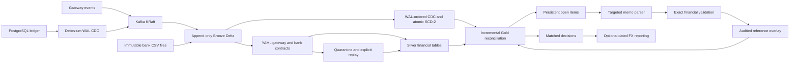

# FinRecon architecture walkthrough

FinRecon reconciles a payment gateway event, an operational invoice/journal,
and a delayed bank settlement. The verified edition runs on one local Docker
host with Spark and Delta. The original managed Databricks stack is a migration
target, not the deployed runtime.

The local orchestrator serializes publication and runs 19 Silver plus 16 Gold
quality checks. The optional eighth stage values matched payments using an
explicit rate book. [Recorded evidence](evidence/local_validation.json) contains
aggregate results; [the run guide](../operations/READY.md) reproduces them.

## Follow one payment

Use this **illustrative**, same-currency payment to explain the system. It is not
an additional measured record: invoice
`INV-00000000-0000-4000-8000-000000000001`, gateway reference `GW-EXAMPLE`, INR
`125.0000`, and two journal legs: one debit and one credit of INR `125.0000`.

1. The producer commits clean ledger postings and records pending gateway work
   in a durable SQLite outbox. A lost acknowledgement must not post another journal.
2. Debezium captures the invoice's `ISSUED` and `PAID` states. Bronze retains
   source envelopes, original strings, duplicate messages, and Kafka coordinates.
3. Silver evaluates contracts with native Spark expressions. A negative amount
   is quarantined. Exact gateway retries retain one business posting within the
   seven-day window. Raw Bronze remains available.
4. CDC applies source WAL order. The invoice's two business states become two
   SCD versions through one atomic union-source MERGE for that dimension.
5. Before the bank arrives, the invoice remains an open item. The next run can
   reconsider it from current evidence and persisted state without scanning all
   invoice history. The bank's arrival can close the item if every check passes.
6. If the bank has no reference but its memo contains the full invoice UUID, the
   parser proposes a candidate. Gold validates amounts, currency, merchant,
   account state, reference uniqueness, and balanced journals before linking it.

An invoice and an orphan bank record can be two unresolved sides of one payment.
Open-item counts are not automatically counts of additional payments.

## Decisions worth defending

| Decision | Reason | Boundary |
| --- | --- | --- |
| `DECIMAL(18,4)` for monetary outputs | Preserve exact source precision and reject overflow | Sums can widen internally; checked output casts remain required |
| Raw append-only Bronze | Make bad inputs and duplicate delivery inspectable | Checkpoint deletion is not a safe restart procedure |
| Native Spark contract expressions | Evaluate a YAML rule set without Python row UDFs | SQL null results fail the contract |
| Seven-day partition-pruned MERGE | Catch late retries without an all-history key lookup | Older arrivals are quarantined; no global idempotency registry |
| No hot watermark drop today | A watermark can discard a legitimate late first arrival | A future hot path needs a Bronze-backed catch-up path |
| WAL order for CDC | Processing timestamps do not establish database causality | Stable source key/partition ordering is assumed |
| One dimension MERGE for SCD-2 | Close and insert history atomically | Accounts, invoices, journals, and audit are separate transactions |
| Transaction-grain joins | Merchant concentration need not become invoice-key skew | Merchant-key enrichment is benchmarked separately |
| Durable open items and reverse indexes | Reconsider affected matches after bank/account changes | Gold's multiple output tables are not one global transaction |
| Validated reference overlay | Resolve a memo without rewriting raw bank evidence | A later evidence change can invalidate a link and reopen a payment |

Do not describe this as global exactly-once delivery. Kafka can redeliver, and
publication spans separate transactions. The implementation uses checkpoints,
stable identities, atomic table merges, and replay-safe acknowledgements to
protect business effects within the documented scope.

## What the measurements show

The November 18, 2026 end-to-end fixture has 1,000 payments, 1,050 gateway
deliveries, 4,000 correlated CDC events, and 2,000 balanced journal legs. All
1,000 match after ten explicit synthetic corrections and twenty validated memo
links. The shared CDC history retains 1,311 unrelated open items. Retry timing in
this verifier uses a virtual clock; transport and PostgreSQL writes are real.

The separate synthetic skew experiment reaches one million payments and two
million journal legs. At that size, observed median action times were 8,109 ms
for baseline, 5,081 ms for AQE, and 8,229 ms for salting across three trials each.
Salting spread the hot merchant key but did not improve median time. These
measurements are not end-to-end throughput or a general speedup guarantee.
See [the full benchmark results](../pipelines/BENCHMARK_RESULTS.md).

## Recovery proof

Kafka adoption preserved broker identity, topic IDs, offsets, and file metadata.
A coordinated drill then restored physical PostgreSQL data/WAL/slots, Kafka
including Connect topics, Delta tables/checkpoints, and landing files. Isolated
services resumed the existing connector. Bronze read zero old rows, then exactly
six new CDC rows from a cloned INR `1.0000` payment. That payment never reached
original PostgreSQL. A separate retention-loss probe failed explicitly and left
committed Delta data unchanged.

These are single-host recovery proofs. Archives on the same host do not establish
off-host disaster recovery, automatic failover, or independent-host resilience.
Details: [CDC](../pipelines/CDC.md), [Gold](../pipelines/GOLD.md),
[exceptions](../pipelines/EXCEPTIONS.md), and [recovery](../operations/RECOVERY.md).
